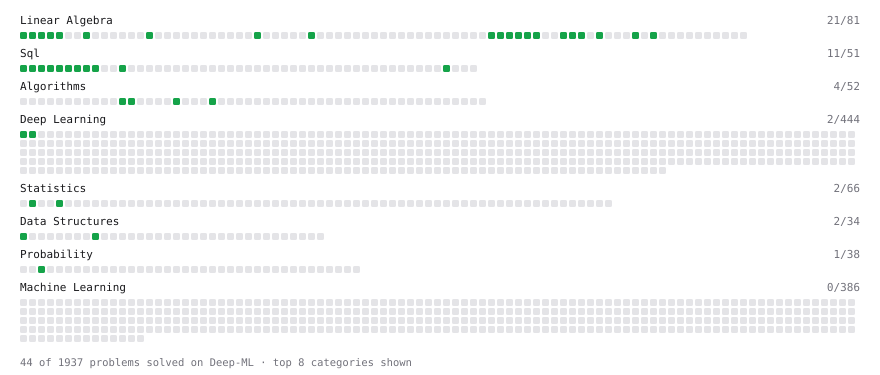

# Deep-ML

My machine learning practice from [Deep-ML](https://www.deep-ml.com). Every solution here was written by hand.

**27** solved · 25 problems · 0 labs · 2 math

[**Browse the interactive portfolio**](https://SaiSrinivasPedada.github.io/deep-ml/) to replay this filling in over time.

## Problems

| | Difficulty | Solved | |
| --- | --- | --- | --- |
| [Add Two Numbers as Linked Lists](https://www.deep-ml.com/problems/1086) | easy | 2026-10-25 | [solution](problems/1086-add-two-numbers-as-linked-lists) |
| [Average per group](https://www.deep-ml.com/problems/1108) | easy | 2026-10-31 | [solution](problems/1108-average-per-group) |
| [Calculate Cosine Similarity Between Vectors](https://www.deep-ml.com/problems/76) | easy | 2026-11-06 | [solution](problems/0076-calculate-cosine-similarity-between-vectors) |
| [Calculate Mean by Row or Column](https://www.deep-ml.com/problems/4) | easy | 2026-11-06 | [solution](problems/0004-calculate-mean-by-row-or-column) |
| [Count rows per group](https://www.deep-ml.com/problems/1107) | easy | 2026-10-31 | [solution](problems/1107-count-rows-per-group) |
| [Count Words Appearing Exactly Once in Each of Two Lists](https://www.deep-ml.com/problems/1141) | easy | 2026-10-25 | [solution](problems/1141-count-words-appearing-exactly-once-in-each-of-two-lists) |
| [Delete Duplicate Emails Keeping One](https://www.deep-ml.com/problems/1112) | easy | 2026-10-31 | [solution](problems/1112-delete-duplicate-emails-keeping-one) |
| [Derivative of a Polynomial](https://www.deep-ml.com/problems/116) | easy | 2026-10-31 | [solution](problems/0116-derivative-of-a-polynomial) |
| [Descriptive Statistics Calculator](https://www.deep-ml.com/problems/78) | easy | 2026-11-06 | [solution](problems/0078-descriptive-statistics-calculator) |
| [Empirical Probability Mass Function (PMF)](https://www.deep-ml.com/problems/184) | easy | 2026-10-31 | [solution](problems/0184-empirical-probability-mass-function-pmf) |
| [Filter rows with WHERE](https://www.deep-ml.com/problems/1103) | easy | 2026-10-31 | [solution](problems/1103-filter-rows-with-where) |
| [First N Fibonacci Numbers](https://www.deep-ml.com/problems/1151) | easy | 2026-10-25 | [solution](problems/1151-first-n-fibonacci-numbers) |
| [Matrix-Vector Dot Product](https://www.deep-ml.com/problems/1) | easy | 2026-11-06 | [solution](problems/0001-matrix-vector-dot-product) |
| [Min-Max Scaling of Feature Values](https://www.deep-ml.com/problems/112) | easy | 2026-10-25 | [solution](problems/0112-min-max-scaling-of-feature-values) |
| [Poisson Distribution Probability Calculator](https://www.deep-ml.com/problems/81) | easy | 2026-10-25 | [solution](problems/0081-poisson-distribution-probability-calculator) |
| [Remove duplicates with DISTINCT](https://www.deep-ml.com/problems/1105) | easy | 2026-10-31 | [solution](problems/1105-remove-duplicates-with-distinct) |
| [Reshape Matrix](https://www.deep-ml.com/problems/3) | easy | 2026-11-06 | [solution](problems/0003-reshape-matrix) |
| [SELECT all rows](https://www.deep-ml.com/problems/1101) | easy | 2026-10-31 | [solution](problems/1101-select-all-rows) |
| [Select specific columns](https://www.deep-ml.com/problems/1102) | easy | 2026-10-31 | [solution](problems/1102-select-specific-columns) |
| [Sort results with ORDER BY](https://www.deep-ml.com/problems/1104) | easy | 2026-10-31 | [solution](problems/1104-sort-results-with-order-by) |
| [Top N with LIMIT](https://www.deep-ml.com/problems/1106) | easy | 2026-10-31 | [solution](problems/1106-top-n-with-limit) |
| [Top-K Largest Elements in a List](https://www.deep-ml.com/problems/1137) | easy | 2026-10-25 | [solution](problems/1137-top-k-largest-elements-in-a-list) |
| [Transpose of a Matrix](https://www.deep-ml.com/problems/2) | easy | 2026-11-06 | [solution](problems/0002-transpose-of-a-matrix) |
| [Valid Palindrome II (Delete At Most One Char)](https://www.deep-ml.com/problems/1160) | easy | 2026-10-25 | [solution](problems/1160-valid-palindrome-ii-delete-at-most-one-char) |
| [Your first JOIN](https://www.deep-ml.com/problems/1109) | easy | 2026-10-31 | [solution](problems/1109-your-first-join) |

## Math

| | Difficulty | Solved | |
| --- | --- | --- | --- |
| [Matrix Basics](https://www.deep-ml.com/math-problems/9) | easy | 2026-10-25 | [solution](math/0009-matrix-basics) |
| [Vector Operations](https://www.deep-ml.com/math-problems/7) | easy | 2026-10-25 | [solution](math/0007-vector-operations) |

---

_This file is regenerated by Deep-ML on every push._
