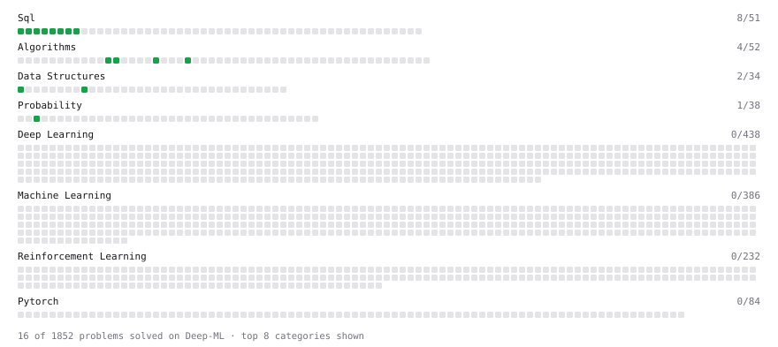

# Deep-ML

My machine learning practice from [Deep-ML](https://www.deep-ml.com). Every solution here was written by hand.

**10** solved · 8 problems · 0 labs · 2 math

[**Browse the interactive portfolio**](https://SaiSrinivasPedada.github.io/deep-ml/) to replay this filling in over time.

## Problems

| | Difficulty | Solved | |
| --- | --- | --- | --- |
| [Add Two Numbers as Linked Lists](https://www.deep-ml.com/problems/1086) | easy | 2026-10-25 | [solution](problems/1086-add-two-numbers-as-linked-lists) |
| [Count Words Appearing Exactly Once in Each of Two Lists](https://www.deep-ml.com/problems/1141) | easy | 2026-10-25 | [solution](problems/1141-count-words-appearing-exactly-once-in-each-of-two-lists) |
| [Derivative of a Polynomial](https://www.deep-ml.com/problems/116) | easy | 2026-10-31 | [solution](problems/0116-derivative-of-a-polynomial) |
| [First N Fibonacci Numbers](https://www.deep-ml.com/problems/1151) | easy | 2026-10-25 | [solution](problems/1151-first-n-fibonacci-numbers) |
| [Min-Max Scaling of Feature Values](https://www.deep-ml.com/problems/112) | easy | 2026-10-25 | [solution](problems/0112-min-max-scaling-of-feature-values) |
| [Poisson Distribution Probability Calculator](https://www.deep-ml.com/problems/81) | easy | 2026-10-25 | [solution](problems/0081-poisson-distribution-probability-calculator) |
| [Top-K Largest Elements in a List](https://www.deep-ml.com/problems/1137) | easy | 2026-10-25 | [solution](problems/1137-top-k-largest-elements-in-a-list) |
| [Valid Palindrome II (Delete At Most One Char)](https://www.deep-ml.com/problems/1160) | easy | 2026-10-25 | [solution](problems/1160-valid-palindrome-ii-delete-at-most-one-char) |

## Math

| | Difficulty | Solved | |
| --- | --- | --- | --- |
| [Matrix Basics](https://www.deep-ml.com/math-problems/9) | easy | 2026-10-25 | [solution](math/0009-matrix-basics) |
| [Vector Operations](https://www.deep-ml.com/math-problems/7) | easy | 2026-10-25 | [solution](math/0007-vector-operations) |

---

_This file is regenerated by Deep-ML on every push._
